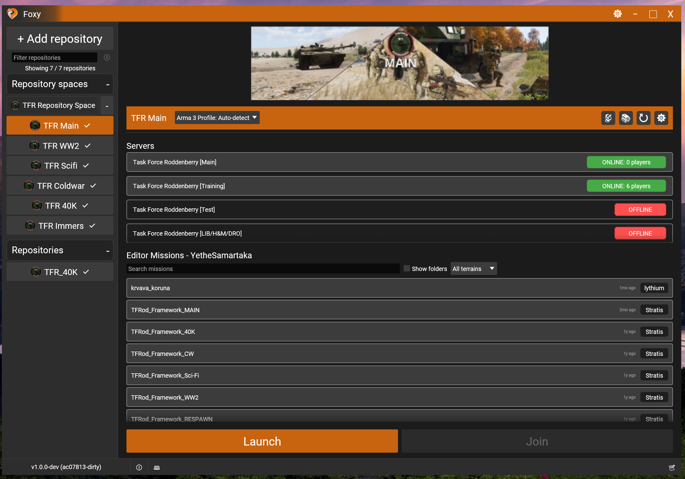
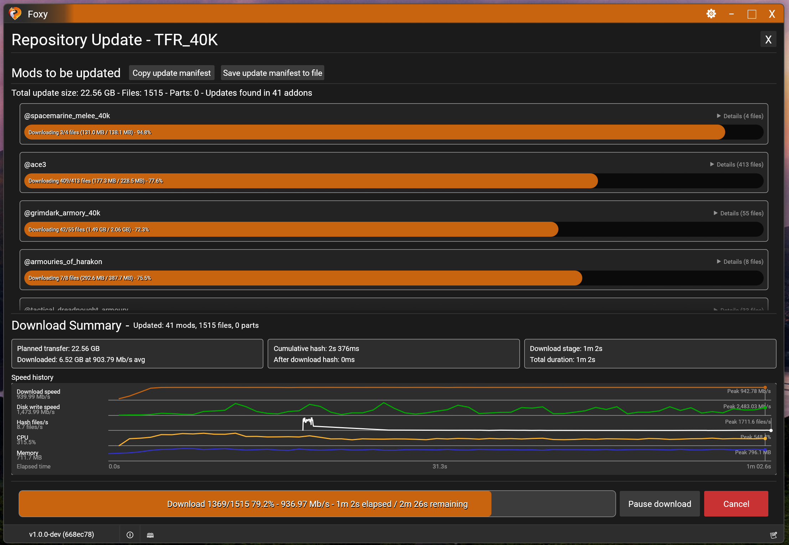
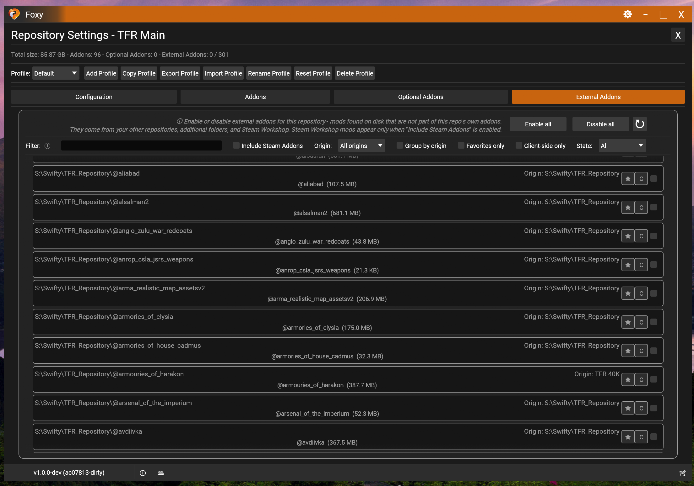

# Foxy

Foxy is a modern repository updater (Intended primarily for Arma 3 from the start) built from the ground up for speed, reliability, and automation.
It ships as a single binary with both a full desktop UI and a scriptable CLI, runs on Windows and Linux (with early experimental macOS support), and is designed to replace legacy updaters without leaving anyone behind.

## Screenshots







## Why Foxy

- **Fast, reliable synchronization** - Foxy keeps mod repositories up to date with remote refresh, quick checks, rechecks, filesystem drift detection, and tree-hash verification. FoxyMode uses BLAKE3 for fast local hashing while preserving MD5 compatibility for legacy Swifty repositories. Hashing adapts to SSDs and HDDs, and after a database rebuild, files Foxy already verified and that have not changed are restored from a verified-hash record instead of being read again.
- **Safe storage handling** - Foxy checks the drives behind its paths (FAT32/exFAT limits, network shares, RAM disks, read-only volumes, Windows path length) and free space before writing, probes a repository before a force redownload deletes anything, scopes repository deletion to its address and local folder, and lets only one operational Foxy process own a configuration directory, including all its game spaces, at a time.
- **Checks that say what they did** - Quick local checks stay offline and use lightweight drift detection. Refresh checks server metadata and local drift, and full integrity checks read selected files and can diagnose them against cached metadata when offline. Periodic idle metadata checks default to 30 minutes and never start downloads.
- **Completion estimates for the whole update** - Learn from successful updates of each installation to estimate preparation, transfer and patching, verification, saving, and queued repository updates. Unknown work and pauses stay explicit, and the separate transfer estimate never claims the update is finished before verification and saving.
- **Bandwidth-saving updates** - Delta patching downloads only changed file parts, validates the result, and automatically falls back to a full-file download if patching cannot be completed safely. Temporary failures retry automatically, and interrupted transfers resume from the bytes already received.
- **Resource and network controls** - A CPU usage limit, CPU thread count, work and disk priority, storage type and memory pressure overrides, a progress frame rate, and system, direct, or manual proxy settings keep Foxy out of a running game's way and working on restricted networks. They live in Application settings, and all but the frame rate are also available through `foxy settings set`.
- **Repository and profile management** - Manage multiple repositories, repository spaces, visual folders for grouping/coloring/collapsing repositories, launch profiles, optional addons, external addons, backups, drag-and-drop ordering, and bulk sync operations with selective include/exclude filtering. Create a blank local repository to combine installed mods from disk, Steam Workshop, and other repositories without a server.
- **Arma 3 integrations** - Detect Steam and the Arma 3 installation automatically, manage Arma 3 profiles (detect, rename, clone, delete), and keep three versions of automatic daily profile backups with restore and ZIP export. Recognize Steam Workshop addons, validate TeamSpeak 3 and Steam before launch, and support server quick-join flows with repo-provided launch parameters, DLC metadata, and an offer to match the Creator DLCs the server runs.
- **Daily workflow tools** - Repository filtering, addon file search, editor mission scanning, mission open/duplicate/delete actions, dependency cleanup, scheduled rechecks, automatic downloads, and optional post-job close or shutdown actions are available from the app.
- **Clear update visibility** - Download screens show per-addon progress, update summaries, toast notifications, transfer history graphs, adaptive speed limits, and grouped download/disk/hash performance metrics. Work in progress stays visible and alive: checks draw a sparkling map of triangles for the data being hashed, progress bars fill the same blinking triangles with flowing, bubbling mana, and the sidebar shows a round cluster of triangles per repository. **Reduce motion** turns the animations off.
- **Game spaces** - Each supported game gets its own workspace with separate settings, repositories, stores, benchmarks, and database, switchable at runtime and remembered across launches. Arma 3 is the reference module; Total War: WARHAMMER III (`.pack` repositories and the `used_mods.txt` manifest) and Arma Reforger (`-addons`/`-addonsDir` launch and server join) ship alongside it, and a Generic game module covers other games with a user-supplied executable, arguments, and mods manifest, and can download and delta-update the game build itself from a repository.
- **Application modes** - Client is the default. Server mode offers versioned Arma 3/Reforger instance drafts, adoption of native installations, configuration snapshots, verified immutable content stages, contained repository acquisition, offline deployment records and prepared generations, plus reviewed native activation, recovery and foreground lifecycle for exact tested Arma and Reforger builds. Activation copies the runtime and preserves the adopted source. Reforger addon acquisition uses an isolated vendor engine and retains exact versions and dependency provenance separately from desired latest intent. Native Steam installs and immutable update/repair successors support Arma 3 and separate Stable/Experimental Reforger apps. See the server guide for compatibility and acceptance limits.
- **Steam Workshop management** - Import Workshop items by id, URL, collection, or share code, set the load order, freeze mods against Steam updates, compare setups with a state checksum, and exchange `.foxyshare` bundles, from the game space settings or the CLI.
- **Safer launches and setup changes** - Launch and Join wait for active updates to settle, report a successful command handoff without claiming the game connected, and restore prepared files after a failed handoff. Extra-file activation reviews edited destinations and ordered overlaps, with a CLI dry run that lists the required choices before writing. Space switches prepare the destination before leaving the current workspace, config-pack imports recover as a complete setup, and removing a game space lets you preserve its private frozen mods and extra files.
- **Reviewed file and backup operations** - Direct downloads preview existing-file collisions and require `--overwrite --yes` to replace them. Backup restore prefers matching repository origins, while cleanup previews its deletion set and asks separately before deleting the final recovery copy.
- **Addon Workshop pages** - Right-click required, optional, or external addons to open their Steam Workshop or Arma Reforger Workshop page in your browser.
- **Benchmarks** - Save a recheck, update, or redownload as a benchmark with stage timings, transfer and disk charts, CPU and memory use, power source, and speed-of-light ratios, then compare two runs side by side or export one as a ZIP for support.
- **Migration and direct-download workflows** - Guided Swifty migration preserves repositories and spaces, while direct-download mode can fetch repository, addon, or file URLs without a full database sync.
- **One binary, two interfaces** - The same `Foxy` executable provides the desktop UI and a scriptable CLI with `--json`, `--dry-run`, `--yes`, `--quiet`, and `--no-progress` support for automation and accessible output.
- **Cross-platform app delivery** - Native Windows and Linux builds include platform-appropriate installers plus decentralized in-app updates from self-hosted manifests or GitHub Releases, with early experimental macOS builds. The Windows build is also confirmed to work on Linux under Proton and Wine.
- **Customizable, accessible UI** - Themes support import/export, presets, scaling, and toast feedback. Keyboard navigation, locale-aware formatting, scalable fonts, clear status messages, non-color-only indicators, and a Reduce motion setting are built in.
- **Broad localization** - Built-in localization bundles cover `en`, `ar`, `bg`, `bn`, `cs`, `da`, `de`, `el`, `es`, `et`, `fa`, `fi`, `fr`, `he`, `hi`, `hr`, `hu`, `id`, `it`, `ja`, `ko`, `lt`, `lv`, `nb`, `nl`, `pl`, `pt`, `pt-BR`, `ro`, `ru`, `sk`, `sl`, `sr`, `sv`, `th`, `tl`, `tr`, `uk`, `ur`, `vi`, and `zh`.

Current workspace status:
- Main app crate: `Foxy` (Rust `1.96`, edition `2024`)
- Companion crate: `foxy-server-backend-cli` (repository generation + app updater manifest tooling)
- UI stack: `egui` / `eframe`
- Core/data stack: `Turso` (pure-Rust, async, SQLite-compatible engine)

## Documentation

- [User Guide](wiki/User-Guide.md) - game spaces, repositories, syncing, launching, Steam Workshop, benchmarks, settings, troubleshooting, and the CLI.
- [Server Admin Guide](wiki/Server-Admin-Guide.md) - generating and hosting Arma 3, Arma Reforger, and custom game repositories and repository spaces with `foxy-server-backend-cli`, native Steam session preparation, server launch lines and keys, and self-hosted app updates.
- The in-app Help page (**F1**) covers the same ground in every bundled language, with search across topic titles and text.

## Future roadmap

These are planned directions for Foxy. They are not listed in any particular order, and priorities may change.

- Desktop UI for the Reforger GUID addon store, extra-file, and config-pack tools that are currently CLI-only
- Game-space-level profiles that carry a config folder and extra-file selection, for games that do not use repositories
- Steam depot and Workshop content acquisition through native providers
- Further game modules on top of the existing game-space framework

## Installation

### Pre-built installers

Download the latest release from the repository Releases page.

- Windows: run `Foxy-<version>-setup.exe`
- Linux user install: run `chmod +x Foxy-<version>-linux-x86_64-installer.sh && ./Foxy-<version>-linux-x86_64-installer.sh --prefix="$HOME/.local/opt/foxy"`
- Linux system install: run `chmod +x Foxy-<version>-linux-x86_64-installer.sh && sudo ./Foxy-<version>-linux-x86_64-installer.sh`

Windows updates keep saved repositories, settings, and databases. Silent installers always preserve user data; a reset during a manual install requires a fresh selection and confirmation.

Native Linux in-app updates use Foxy's self-extracting `.sh` installer. System installs may prompt for administrator privileges through `pkexec` when the install prefix is not writable.

### Linux, Proton, and Wine

The Windows build of **Foxy is confirmed to work on Linux under both Proton and Wine**. You can also use the native Linux build with the installers above.

For the Windows build, run the Windows installer and Foxy in your chosen Proton or Wine environment. To open the desktop UI from a Wine terminal, run this from Foxy's installation folder:

```bash
wine Foxy.exe ui
```

Windows Foxy can detect and start native Linux Steam, find Arma 3 across its Steam libraries, and launch the game through Steam's selected Proton runtime with your enabled mods and server settings. Native, Flatpak, and Snap Steam installations are supported.

Configure Arma 3 to use Proton in Steam and start it from Steam once before launching it through Foxy. Use **Auto-detect** for the Steam and Arma 3 directories; Foxy translates mod, profile, and editor mission paths for the game's Proton prefix and skips the Arma launcher. See the [Linux launch setup](wiki/User-Guide.md#linux-proton-and-wine).

### Build from source

Requirements:
- Rust `1.96+` (edition 2024)
- Windows MSVC target: Visual Studio C++ build tools
- Windows icon rebuilds only: `windres` (MinGW resource compiler) with `BUILD_ICON=1`. Normal builds link the committed `app_icon.o`.

Main app:
```bash
cargo build --release
```

Foxy's application version comes from the first `# MAJOR.MINOR.PATCH` release heading in `CHANGELOG.md`. The desktop UI, CLI, update checks, and installer builds use that version; `Cargo.toml` retains separate package metadata.

Whole workspace (including the server backend CLI and testkit):
```bash
cargo build --workspace --release
```

Keep the Steamworks library beside the application when copying a build: `steam_api64.dll` on Windows, `libsteam_api.so` on Linux, or `libsteam_api.dylib` on macOS. `build.rs` stages it beside the executable, and the Windows and Linux installers include it.

Pre-release build (release-optimized, version label and logs carry source commit):
```bash
cargo prerelease
```

Pre-release installer (version comes from the changelog and the short commit hash is filled in automatically; output lands in `dist/`, needs Inno Setup 6.7 or later with `iscc` in `PATH`):
```bash
scripts\build-windows-prerelease-installer.bat
```

Build installers:
```bash
# Windows
scripts\build-windows-installer.bat

# Linux
./scripts/build-linux-installer.sh
TARGET=aarch64-unknown-linux-gnu ./scripts/build-linux-installer.sh

# macOS Apple Silicon, local experimental build
./scripts/build-macos-installer.sh
```

The experimental macOS DMG script currently copies only the executable into the app bundle. The installed `Foxy.app/Contents/MacOS/` directory also needs the built `libsteam_api.dylib` beside `Foxy` before the app can start.

Native Windows-to-macOS installer builds are not supported by this repo. The macOS dmg path needs macOS SDK/linker support and `hdiutil`. From Windows, use an SSH-accessible Mac and copy the dmg back:
```powershell
pwsh scripts\build-macos-installer.ps1 -RemoteHost user@mac-host -RemoteRepoPath /Users/user/Foxy
```

Linux cross-build from Windows (Docker/Podman):
```bash
cargo install cross
cross build --release --target x86_64-unknown-linux-gnu
```

Native Linux dependencies (Ubuntu/Debian example):
```bash
sudo apt-get install -y pkg-config libssl-dev libgtk-3-dev \
  libx11-dev libxi-dev libxrandr-dev libxinerama-dev libxcursor-dev \
  libxkbcommon-dev libwayland-dev libudev-dev libasound2-dev \
  libgl1-mesa-dev libxcb-render0-dev libxcb-shape0-dev libxcb-xfixes0-dev
cargo build --release
```

## CLI Usage

Behavior:
- Desktop launch (or no-arg non-terminal launch) opens UI
- Terminal no-arg launch prints CLI help in release builds
- Debug builds open UI on no-arg launch for faster iteration
- `foxy ui` (or `foxy ui --debug-mode`) explicitly launches UI from terminal
- `foxy ui --mode client|server` selects the UI mode for one session; `foxy settings set --app-mode client|server` saves its default. Existing CLI commands keep their behavior in either mode.
- `foxy ui --debug-modal <app-update|db-schema-wipe|storage-check>` opens a startup modal with placeholder data for inspection (repeatable); the modal's real actions stay disabled
- Commands work on the active game space; `foxy game use <id>` switches it for later CLI runs and the next UI start

### Global flags

| Flag | Description |
|------|-------------|
| `--config-dir <path>` | Override config root directory |
| `--json` | Emit machine-readable JSON output |
| `--toon` | Emit machine-readable TOON output; implies `--json` behavior |
| `--quiet` | Reduce informational output |
| `--no-progress` | Disable live progress output |
| `--yes` | Confirm destructive operations |
| `--dry-run` | Preview behavior without writing changes, for commands that support it |
| `--wipe-db` | Wipe and rebuild the entire local database after a schema upgrade; requires `--yes` |

### Commands

| Command | Description |
|---------|-------------|
| `ui [--mode client\|server]` | Launch desktop UI with an optional session-only mode |
| `version` | Print Foxy version, build kind, and source commit (`--version` prints the same label) |
| `settings show\|set\|reset` | Inspect/modify settings; `set --app-mode client\|server` saves the UI mode |
| `settings set --retry-failed-downloads <true\|false>` | Control automatic retries of temporary desktop update failures (enabled by default) |
| `settings set --periodic-remote-check-enabled <true\|false>`, `--periodic-remote-check-interval-minutes <5-1440>` | Control idle repository metadata checks (enabled every 30 minutes by default) |
| `settings set --cpu-usage-limit <10-100>`, `--cpu-usage-unlimited`, `--cpu-threads <N>`, `--cpu-threads-auto`, `--cpu-safe-limits <true\|false>` | Limit how much processor time and how many threads Foxy's work uses |
| `settings set --work-priority <normal\|below-normal\|lowest>`, `--low-disk-priority <true\|false>` | Lower Foxy's processor and disk priority on Windows |
| `settings set --storage-type <auto\|ssd\|hdd\|removable>`, `--memory-pressure <auto\|normal\|constrained\|severe>` | Override drive detection or the measured memory level |
| `settings set --proxy-mode <system\|none\|manual>`, `--proxy-url`, `--proxy-username`, `--proxy-password`, `--proxy-bypass` | Choose how Foxy reaches the network |
| `repo list\|add\|remove\|clone\|sync\|wipe-db\|force-redownload` | Repository operations |
| `sync` | Alias of `repo sync` |
| `addon list\|set\|recalc-hashes\|force-redownload` | Addon operations |
| `profile list\|select\|add\|delete` | Profile operations |
| `space list\|sync` | Repository space operations |
| `game list\|use\|create\|remove\|launch` | Game space operations; removing a space with private payloads requires `--preserve-payloads` or `--discard-payloads`; `game reforger ...` manages Arma Reforger addons by GUID |
| `workshop list\|add\|import\|remove\|unsubscribe\|set\|order\|freeze\|unfreeze\|pins\|export\|share\|checksum\|bundle\|resolve` | Steam Workshop items of the active game space; remove unregisters locally, unsubscribe is a separate Steam action |
| `config export\|import` | Export or import a `.foxypack` config pack |
| `config extra-file list\|add\|remove\|set\|activate` | Managed extra files |
| `server inspect-addons` | Inspect the addons an Arma 3 server reports |
| `server steam status\|login\|resume\|anonymous\|forget [--game-space <id>]` | Inspect or prepare a protected native Steam session; credentials and Guard codes are never accepted as command arguments |
| `server installation install plan\|apply <instance-id> --directory <new-folder> [--channel stable\|experimental] [--branch <name>] [--account <alias>\|--anonymous]` | Review Steam read-only, then download, verify and atomically publish a managed dedicated server into a new folder and bind it; apply needs `--yes` and the plan fingerprint |
| `server installation check <instance-id> [--account <alias>\|--anonymous]` / `validate <instance-id>` | Compare the managed build with Steam or verify the complete local inventory offline without writes |
| `server installation update\|repair plan\|apply <instance-id> --directory <new-folder> [--channel stable\|experimental] [--branch <name>] [--account <alias>\|--anonymous]` | Publish a verified successor on the installed channel and switch only this instance, retaining the previous installation; physical consumer gates, `--yes` and fingerprint apply |
| `server workshop list\|plan\|acquire\|verify [<item>...] [--account <alias>\|--anonymous] [--repair]` | Review, download, verify and pin Arma 3 Workshop items as `workshop-<id>` content profiles; acquire needs `--yes` and the plan fingerprint |
| `server headless list\|add\|set\|remove\|plan\|status\|start\|stop\|restart <instance-id> ...` | Define Arma headless clients and their start and restart policy in the draft, review their committed launch plans, show each client's owner-observed state and join evidence, and start, stop or restart all of them or one with `--client`; start, stop, restart and remove need `--yes` |
| `server context [--game-space <id>]` | Inspect server-mode paths and support status without opening a database or changing the remembered space |
| `server supervise --game-space <id>` | Host a foreground metadata owner with an exclusive space claim and no Turso engine |
| `server owner --game-space <id>` | Authenticate and inspect that owner; supports the normal JSON/TOON output |
| `server capabilities [--game-space <id>]` | Report implemented draft operations and remaining server-operation gates |
| `server instance list\|show\|add\|clone\|rename\|replace\|validate\|remove [--game-space <id>]` | Manage versioned Arma 3/Reforger drafts; edits require revisions, removal requires `--yes`, mutations support `--dry-run` |
| `server instance start-plan\|start\|status\|stop\|restart <id> [--game-space <id>]` | Review and control an exact activated native Arma or Reforger runtime through a foreground owner; actual effects require reviewed generations and `--yes` |
| `server installation list\|inspect [--game-space <id>]` | Inspect existing native x64 server executables without running or changing them |
| `server installation consumers <installation-id> [--game-space <id>]` | Inspect registered consumers and recovery intent/receipt metadata with bounded local evidence; no liveness or maintenance authority |
| `server instance recovery-plan <id>` / `recover <id> --expected-plan-fingerprint <hash> --yes` | Review native crash cleanup evidence, then retire the exact exit-proven old-owner consumer group through an authenticated replacement owner; unknown records stay blocked |
| `server maintenance list\|add\|set\|remove\|run\|cancel\|history <instance-id> ...` | Schedule one-time or weekly maintenance jobs that the running server owner executes; restart runs through the reviewed start plan and never starts a stopped server, update and backup stay blocked; remove, run and cancel need `--yes` |
| `server instance adopt\|bind\|preflight [--game-space <id>]` | Adopt/bind an existing installation or review proposed isolated paths and deployment blockers |
| `server instance render <id> [--game-space <id>]` | Preview typed Arma 3/Reforger configuration without writing |
| `server reforger-addons list\|plan\|acquire <id> [--game-space <id>]` | Review isolated Reforger Workshop acquisition and retain exact addon/dependency versions; acquisition requires `--yes` and the reviewed fingerprint |
| `server configuration plan\|list\|commit\|verify\|rollback [--game-space <id>]` | Review and manage immutable configuration snapshots; no runtime or game files are changed |
| `server content list\|add-folder\|add-profile [--game-space <id>]` | Register addon folders and repository profiles; saves require exclusive space ownership |
| `server content plan <instance-id> --bindings <file> [--game-space <id>]` | Preview independent source roles/order and path blockers without downloads or copies |
| `server content bindings show\|plan\|save <instance-id> [--game-space <id>]` | Retain reviewed per-instance selections with stale-input protection; no content acquisition or deployment |
| `server content stage plan\|apply\|verify\|list <instance-id> [--game-space <id>]` | Hash saved already-present content and retain or verify immutable unselected stages; only actual apply claims the space, and no stage opens the sync database |
| `server content acquire plan\|apply <instance-id> [--game-space <id>]` | Review saved download profiles offline, then acquire and verify them into one inactive retained stage using contained scratch workers |
| `server deploy plan <id> [--stage <id>] [--expected-revision <n>] [--expected-configuration-generation <n>] [--game-space <id>]` | Produce a read-only composition report from the persisted active configuration and an explicitly selected retained stage |
| `server deploy prepare|commit|list|verify ...` | Prepare and save an immutable offline record, inspect its ID inventory, or verify its referenced archives; save requires the exact reviewed fingerprint |
| `server deploy select-plan|select <id> <record-id> ...` | Review and explicitly select an indexed offline record; select requires the reviewed fingerprint and `--yes` unless dry-run |
| `server deploy runtime plan|build|list|verify ...` | Review, build, inventory or verify immutable copies of the selected offline record; build does not activate runtime files |
| `server deploy activation plan|apply|status|recovery-plan|resolve ...` | Review and activate an exact native Arma or Reforger runtime generation or review and resolve its transaction; apply/resolve require the review fingerprint and `--yes` except dry-run |
| `server content consumers [--game-space <id>]` | Report exact source/repository identities, same-root cross-space profiles, and instance consumers; physical-installation registrations are cross-root |
| `server deploy pins|pin|unpin ...` | Inspect or change retained deployment-record pins with generation guards; changes require `--yes` |
| `server deploy reconcile plan|apply <id> ...` | Review and reclaim unreferenced instance artifacts; apply requires the exact plan fingerprint and `--yes` |
| `direct-download` | Download by URL without full sync; replacing existing files requires `--overwrite --yes` |
| `launch` | Build or execute the game launch command for a repository and profile; `--allow-live-fallback` and `--allow-incomplete-preparation` consent to a degraded launch once |
| `agent-gui ...` | Drive a running UI started with `ui --agent-gui` (developer tooling) |

Exit codes: `0` success, `2` validation error, `3` not found, `4` operation failed, `5` partial success, `6` busy (another Foxy process owns the configuration directory or the game space database).

Database commands resolve the remembered game space before claiming it. If exclusive access cannot be verified, Foxy refuses access with code `4`; another active owner remains code `6`. `server context` reads an existing `games.json` without migrations, repairs, directory creation, or log writes. Missing or invalid configuration returns code `2`. Server management commands reject `--wipe-db` before creating locks or preparing the game space.

Server draft commands also capture an existing space without remembering it. Inspection, validation and dry runs write nothing and can run beside the GUI. Draft saves use a temporary exclusive space claim or a serialized metadata permit from its authenticated foreground owner, without opening its database. Server desktop and CLI can edit through the same owner; a client GUI's database claim still blocks CLI saves. Draft commands reject `--wipe-db`; native lifecycle is a separate reviewed operation available for the exact accepted Arma and Reforger runtimes. See [server drafts](wiki/Server-Admin-Guide.md#server-instance-drafts), [Arma foreground lifecycle](wiki/Server-Admin-Guide.md#arma-foreground-lifecycle) and [Reforger foreground lifecycle](wiki/Server-Admin-Guide.md#reforger-native-adoption-and-foreground-lifecycle).

Installation inspection shows local executable-version metadata on Windows, matching Arma Steam build/branch metadata when available, and exact executable matches to the tested Arma 2.22 layout on Windows and Linux. Activation accepts only that exact executable fingerprint/layout; acceptance evidence does not establish general engine compatibility or broad platform release support.

Server content staging is capability-enabled on native Windows and Linux for Arma 3 and Reforger spaces. Plan and verify hash bytes without acquiring the DB claim; stage listing is inventory only. Apply `--dry-run` rebuilds and checks the exact plan without a claim or writes; a real apply claims only its captured game space and retains a verified archive under that instance. Native Windows/Linux Arma activation acceptance exercised local retained stages; it does not establish provider acquisition or general server readiness. Stages themselves do not download or activate content.

`server deploy plan` reads the persisted active configuration selection and never follows a configuration revision highlighted only in UI history. Pass `--stage <id>` to inspect that exact retained archive; omitting it reports a missing-stage blocker without selecting the newest stage. The deterministic report fingerprint is evidence only, not authority to apply. Completed reports exit `0` even with blockers; stale expected revisions/generations exit `2`, a missing instance exits `3`, and corrupt state or storage failures exit `4`. A corrupt selected archive is reported as an integrity blocker. The command is read-only, may run while the game-space database is busy, and rejects `--wipe-db`. It performs no database open or claim, logger initialization, filesystem writes, network work, or adopted executable hash check. `--dry-run` runs the same plan.

`server deploy select-plan <id> <record-id> --expected-deployment-generation <n>` verifies an indexed target and both pinned archives, then returns a review fingerprint. `server deploy select` requires that same generation and `--expected-plan-fingerprint`, plus `--yes` for every non-dry-run invocation, including a no-op. `--dry-run` needs no `--yes` and performs no claim or write. Selection changes only `deployments/state.json`; it creates or deletes no archives, does not change the current draft or other configuration/content intent, and does not activate or start anything. Selecting the already selected record leaves the generation unchanged. Planning and dry-run may run beside the database owner; a real selection claims the captured space but never opens Turso.

Deployment records are available on supported native Windows/Linux builds. `prepare` reviews the persisted active configuration and explicit retained stage and returns an immutable manifest ID plus a plan fingerprint. `commit` takes the same inputs, reruns the review, then stores the record and updates only the offline selection state. `list` returns saved IDs and selection generation without verifying file integrity; `verify` checks the record manifest and both referenced archives without consulting current source files. The record manifest references immutable configuration and content archives rather than copying them, and Foxy does not garbage-collect those archives. Preparation and verification are read-only and can run beside a busy database owner; only an actual commit claims the captured game space, and none of these commands opens Turso. Commit `--dry-run` verifies the exact plan without claiming or writing. Cancellation is cooperative; the caller waits for owned temporary cleanup. Interrupted commits may leave a complete unselected record, and unknown files are preserved. These records do not activate a runtime deployment, prove engine/provider readiness, or start a process.

`server deploy runtime plan|build|list|verify` adds a separate offline preparation copy of the selected indexed record. Plan/build require `--expected-deployment-generation`; build also requires the exact `--expected-plan-fingerprint`. The immutable copy contains the full configuration archive and content stage under `deployments/prepared/prepared_<hash>/` and has its own strict manifest/integrity verification. Plan and dry-run are write-free; an actual build claims the captured game space without opening Turso. Verify uses only the copied generation and does not depend on the original archives, but still requires a valid current game-space context and instance. The UI may plan from the loaded record while draft edits are unsaved. Build does not change selection, install or activate runtime files, start a process, acquire a lease, or clean up other entries. Prepared files are not an engine runtime layout and do not imply readiness. Windows and WSL D05 acceptance exercised the local prepared-copy path; it does not establish provider acquisition or broad platform release support.

`server deploy activation plan|apply|status|recovery-plan|resolve` implements reviewed native runtime activation for the exact tested Arma `2.22.154089` and Reforger `1.9.0.37` executable/layout patterns on Windows and Linux x64. Windows and WSL acceptance passed for eight fresh engine generations, activation/rollback, persistence and three owner interruption/recovery scenarios. This evidence does not imply broad platform release support. Plan binds an explicit prepared generation, deployment-selection generation, activation generation, saved instance/catalog evidence, installation fingerprint and selected payload into a review fingerprint. Apply recomputes that plan; real apply requires the fingerprint and `--yes`, then runs through the authenticated foreground owner and installation/transaction admission without opening Turso. Global `--dry-run` verifies the exact plan without starting an owner or writing. Status verifies the active runtime. Recovery-plan reviews retained transaction evidence; resolve recomputes the review and requires its fingerprint and `--yes` except for dry-run. After an uncertain owner result, inspect status and recovery-plan before retrying. Runtime files are private complete copies; the adopted installation and preparation source remain unchanged. The Arma boundary includes the selected base engine payload, reviewed configuration, mission templates, server-only staged addons and unchanged tested base `a3` key. Extra or changed keys and client-required/optional addon trust remain unsupported. Reforger activation copies the reviewed engine payload and `server.json` for an explicit IPv4 bind address, distinct game/A2S ports, a built-in scenario and empty addon intent. It does not copy Arma keys or addon content. Per-instance profile/config/cache/runtime state is separate and mutable. Activation never starts the engine. Reviewed owner-routed Start/Status/Stop/Restart for those exact Arma and Reforger runtimes are separate operations. See the server guide for the tested scope.

Content-source discovery covers game spaces under the same config root; repository identity remains `(URL, local path)`. Physical-installation consumer registrations are shared across config roots. Do not register private stage or runtime-copy folders as external content sources; use an external shared content root and pin records that must remain available. Reconciliation removes only manifest-owned trees with full file hashes, refuses live or uncertain consumers, and recovers interrupted quarantine deletion only from a durable receipt scoped to the config context, instance, artifact kind and original owned name. Plans and dry runs do not open Turso. Reconciliation requires a reviewed fingerprint and `--yes` to apply, never wipes the database, and never retires consumer registrations.

`server capabilities --json` includes runtime prerequisites. Instance preflight verifies the selected configuration archive, compares it with the current draft and inspects registered installation consumers without writing. Shared supervisor primitives have native Windows and Linux fixture proofs. Linux requires an ordinary user and permitted user/PID namespace APIs. Persistent registrations block maintenance after uncertain cleanup; Windows and WSL D05 native activation/recovery acceptance passed for the exact tested Arma layout. Owner-routed Arma and Reforger Start/Status/Stop/Restart use the separately reviewed native runtime and retained sessions. Server mode drains client work, closes its database and authenticates a separate metadata owner. The desktop and attached metadata CLI use serialized owner permits without opening Turso; client schedules remain paused until ownership returns. `server supervise --game-space <id>` hosts the owner and `server owner --game-space <id> --json` inspects it. Explicit detach is available as described below; launch-plan stays read-only and Start uses an authenticated owner.

Server lifecycle status now includes cached process/query health, freshness, CPU/RSS history and sanitized bounded logs. Use `server instance monitor <id> --game-space <space>` for a snapshot, `server instance logs <id> --limit 20 --game-space <space>` for a tail, or opt into framed NDJSON with `monitor <id> --follow --stream-json`. Query readiness does not establish joinability or scenario readiness. Desktop Server mode presents the same observations with log search, pause, copy and export.

Explicit **Detach owner and keep server running** preserves supervision after the desktop closes. The CLI supports `server supervise --detach --yes` and reviewed `server instance start <id> --detach --yes`; reconnect with `server owner`, optionally replaying bounded scoped events with `--events-after`. Stop every instance before `server supervise --shutdown --yes` releases the detached owner's game space. Default foreground behavior remains available; no OS service is installed.

After an owner crash, **Consumer recovery** reviews independent native cleanup receipts before explicit cleanup. Establish a replacement owner, review `server instance recovery-plan <id>`, then apply its exact fingerprint with `recover`. Pending group members, missing or malformed proof, legacy records, other configuration roots and current-owner records remain protected. Recovery never kills a process or starts a replacement game automatically. See [verified consumer recovery](wiki/Server-Admin-Guide.md).

Arma headless clients are defined per draft with `server headless add|set|remove` or the desktop **Headless clients** editor section. Each gets its own profile and logs, a deterministic addon list and no dedicated-only arguments. The join password reaches it only through an owner-only parameter file. The owner starts each client automatically, in order and after an optional delay, once the running server answers its query port; an explicit start refuses before that. `server headless status` and the desktop lifecycle panel show each client's state, join evidence from its own log, starts and automatic restarts, and offer individual start, stop and restart. A client that exits unexpectedly is restarted with a growing delay up to its restart limit within 10 minutes, then left stopped until started again. A manual stop is never undone automatically. Stopping the server stops its headless clients first, and a server restart brings back the clients that were not stopped by an operator.

Scheduled maintenance (`server maintenance`, or the desktop **Scheduled maintenance** section) keeps up to 16 one-time or weekly jobs per Arma 3 or Reforger instance, in local time or UTC. Only the running server owner executes them, so nothing runs while no owner is running, and a time missed beyond its grace window is skipped. Each occurrence is a durable record claimed exactly once; one interrupted by an owner crash is reported as unknown and never repeated. A restart can wait for an empty server, retries within its limits, and never starts a server an operator stopped. Update and backup jobs are recorded as blocked until those actions exist. A queued Foxy update waits while supervised server sessions or a detached owner are running. See [Scheduled server maintenance](wiki/Server-Admin-Guide.md#scheduled-server-maintenance).

Examples:
```bash
foxy version --json
foxy repo list --json
foxy repo sync --repo-url https://repo.example.invalid:8080/MainRepo/ --mode quick-check
foxy sync --repo-name "MainRepo" --mode remote-refresh
foxy direct-download --address https://repo.example.invalid:8080/file.zip --dest ./downloads --limit-mbps 25
foxy launch --repo-name "MainRepo" --server "ServerAlpha" --execute
foxy game create "Warhammer" --game twwh3
foxy workshop share --json
foxy config export ./my-setup.foxypack
```

## Configuration Data

Foxy stores app-global data at the config root and everything that belongs to one game under `games/<space_id>/`:

| File/Dir | Purpose |
|----------|---------|
| `app_settings.json` | App-global settings (language, renderer, resource limits, proxy, paths, backups, app updates) |
| `games.json` | Game space registry and the active game space |
| `window_state.json` | Window geometry/state |
| `logs/` | Application logs |
| `backups/` | Backup storage |
| `games/<space_id>/game_settings.json` | Settings of that game space (game paths, launch checks, scheduled jobs) |
| `games/<space_id>/profile_backups/` | Arma 3 player profile backups, three versions per profile |
| `games/<space_id>/repositories.json` | Repository definitions and learned update timings per installation |
| `games/<space_id>/local-repositories/<id>/` | Default folder assigned to a blank local repository when no folder is chosen |
| `games/<space_id>/repository_spaces.json` | Repository space definitions |
| `games/<space_id>/repository_visual_folders.json` | Sidebar folders |
| `games/<space_id>/workshop.json`, `extra_files.json`, `reforger_addons.json` | Steam Workshop, extra-file, and Reforger addon stores |
| `games/<space_id>/extra_file_activations.json` | Last activated extra-file destinations, used to review later edits |
| `games/<space_id>/storage_targets.json` | Recorded storage devices of update targets, used to review a changed device |
| `games/<space_id>/database.db` | Turso (SQLite-compatible) database state |
| `games/<space_id>/benchmarks/` | Saved benchmark records and their log slices |
| `games/<space_id>/paused_repositories.json` | Download pauses remembered per repository installation |
| `games/<space_id>/empty_publications.json` | Accepted empty publications and retained-file removal scope |
| `games/<space_id>/interrupted_updates/` | Notices for updates that still need verification after interruption |
| `games/<space_id>/server/servers.json` | Versioned ordered server drafts, adopted installation records and bindings, independent of the disposable database |
| `games/<space_id>/server/servers.v1.<hash>.json` | Exact previous catalog preserved on the first successful v1-to-v2 save |
| `games/<space_id>/server/mission-library/` | Arma mission source pointers and immutable PBO revisions; cycles pin exact revisions and deployment leaves original sources untouched |
| `games/<space_id>/server/instances/<id>/configuration/` | Immutable rendered configuration revisions plus their atomic saved selection; separate from runtime deployment |
| `games/<space_id>/server/credentials/<id>/` | Instance-scoped credential records, protected with current-user DPAPI on Windows or private directory/file permissions on Linux; excluded from portable packs |
| `games/<space_id>/server/instances/<id>/deployments/runtime-state/home/private-configuration/` | Private per-runtime configuration with resolved credentials, created only at native Start |
| `games/<space_id>/server/instances/<id>/content-stages/stage_<manifest-blake3>/` | Immutable verified local content archive and `manifest.json`; never selected as an active deployment |
| `games/<space_id>/server/instances/<id>/deployments/prepared/prepared_<manifest-blake3>/` | Immutable offline copy of one selected deployment record's configuration and content archives; not an engine runtime layout |
| `games/<space_id>/images/` | Cached images |

A legacy flat layout from Foxy 1.1 or earlier is migrated into an Arma 3 game space on first start, and the previous files are kept as `.pre-gamespaces.bak` copies. See `examples/json/appdata/` for sample files.

Default locations:
- Windows: `%APPDATA%\Foxy`
- Linux: `~/.config/Foxy`

Overrides:
- Environment variable: `FOXY_CONFIG_DIR`
- CLI flag: `--config-dir`

Supervisor installation-lock metadata uses the OS user's local data directory at `Foxy/server-installation-locks/`, independently of these overrides. Persistent lock files and consumer registrations coordinate physical installations across config roots and never replace space-scoped server data. Registrations record session identities before execution and remain after uncertain cleanup. Read-only preflight, capabilities and consumer inspection do not create this namespace. Do not remove its files to bypass a recovery blocker.

## Swifty Compatibility

Foxy supports legacy Swifty repositories and can validate against MD5-based remote checksums where required. For server-side generation/migration, use `foxy-server-backend-cli`.

Generation modes:

| Mode | Flag | Output |
|------|------|--------|
| Foxy mode (default) | `--mode foxy` | BLAKE3 + `foxy_addon.json` / `foxy_addons.json` |
| Swifty mode | `--mode swifty` | MD5 + `mod.srf` |
| Hybrid mode | `--mode hybrid` | Both artifact sets side by side |

## Foxy Server Backend CLI

Desktop Server mode and the client binary's `server configuration` commands support [Arma configuration imports and portable instance packs](wiki/Server-Configuration-Import.md), including explicit operator ownership, protected credential references, redacted exports and unresolved-path review. These commands are separate from the repository generator below.

The [Arma mission library](wiki/Arma-Server-Missions.md) imports PBOs/folders or hash-verified HTTP PBOs, preserves source bytes and pins ordered enabled mission-cycle entries to immutable revisions through the existing deployment workflow. Matching commands are under `server mission`.

Build:
```bash
cd foxy-server-backend-cli
cargo build --release
```

Repository generation:
```bash
foxy-server-backend-cli new config.json
foxy-server-backend-cli create config.json ./output
foxy-server-backend-cli create config.json ./output --mode swifty
foxy-server-backend-cli create config.json ./output --mode foxy
foxy-server-backend-cli create config.json ./output --mode hybrid
foxy-server-backend-cli create config.json ./output --app-update-url https://example.com/foxy-app-updater.json
```

For Arma 3, `create` finishes by printing the server `-mod=` line for the generated repository,
and writes the same single line to `<output>/server_mod_line.txt`, so a wrapper
script can read it later:

```bash
foxy-server-backend-cli create config.json ./output --mod-line-prefix mods
# Server mod line:
# -mod=ws;mods/@cba_a3;mods/@ace;
```

Creator DLC codes from `dlcContent` come first, then the enabled required mods.
Client-side mods are always excluded; add `--mod-line-include-optional` to append
the optional mods as well.

Nested mod paths such as `@ace/optionals/@ace_noactionmenu` publish the nested
folder as a standalone `@ace_noactionmenu` mod. Add `--prune-unused-optionals`
to omit the root `optionals` directory from the published `@ace` copy. The
source mod is untouched. When the output still holds an `optionals` directory
from an earlier run, the command lists it and asks for `--yes` before removing
it; a fresh or already-pruned output needs no `--yes`. Put the nested path in
`requiredMods` to include it in the default server line; entries in
`optionalMods` need `--mod-line-include-optional`.

To keep a server launch script in step with the generated repository, list it in
`modLineFiles`:

```json
{
  "repoName": "My Repository",
  "basePath": ".",
  "modLineFiles": ["../server/start-server.cmd", "/opt/arma3/start.sh"],
  "requiredMods": [{ "modName": "@cba_a3", "enabled": true }]
}
```

After a successful generation, every listed file keeps its content except for the
value of the launch parameters Foxy produces: `-mod=` for Arma 3, `-addonsDir`
and `-addons` for Arma Reforger. Quoting is preserved, so
`start.exe "-mod=@old;" -config=server.cfg` becomes
`start.exe "-mod=mods/@cba_a3;" -config=server.cfg` and nothing else on the line
moves. Every occurrence in a file is updated; `--mod=`, `-modules=`, and
`-addons` inside `-addonsDir` are left alone. Relative paths resolve from the
config file's own directory.

A listed file that does not exist, is not UTF-8 text, or has no such parameter to
replace fails the run before any hashing starts, so a typo never leaves a server
silently running the old mod set. `validate` performs the same check, `--dry-run`
lists the files as `update-mod-line` actions without touching them, and the
rewrite runs only once the repository output is published (including with
`--atomic`). In a space, two repositories may not list the same file.

A config with `"game": "reforger"` (`new --game reforger` writes one) hashes the
addon directories the same way, including the `.pak` entries inside them, and
prints an Arma Reforger server line instead: `-addonsDir <prefix or .> -addons
<id,...>`, where each id is the mod's `.gproj` GUID (project ID, `ServerData.json`
id, then folder name as fallbacks). Reforger configs warn about `dlcContent` and
`clientSide`: Creator DLC metadata is ignored, and the client offers no client-side
marking, but mods with `clientSide: true` are still excluded from the generated
server line. The generated `repo.json` carries `"game": "reforger"`.

A config with `"game": "generic"` (`new --game generic` writes one) publishes a
custom game for Generic game spaces. `gameBuild` (`{ "folder", "executable" }`)
names the folder holding the game build, such as a game folder or a single
executable; clients show it as the game instead of an addon and launch its
executable directly. It prints no server line and writes no `server_mod_line.txt`.
Its template sets `"chunking": "content"`, which splits files that are not PBO or PAK
archives at content-defined boundaries (256 KiB to 4 MiB parts) instead of every
5 MB, allowing unchanged regions of a rebuilt executable or data archive to keep
their part checksums so clients can download only changed parts. Any config
may set `chunking`; the default `fixed` output is unchanged.

For local Reforger addons, keep each addon's `addon.gproj`, `.pak` files and
resource database together; an Arma 3-style `addons/` subfolder is not required.
Foxy loads enabled addons with `-addons` and `-addonsDir`. An addon can be loaded
without appearing in Reforger's Workshop manager or its top-right counter;
confirm loading in the game's `console.log` under `Loaded addons` and check its
features in a scenario.

A local-addon dedicated server uses a world `.ent` path:

```text
ArmaReforgerServer.exe -server "worlds/MP/Coop_CombatOps_Arland.ent" -addonsDir "R:\Mods\MainRepo" -addons ABCDEF1234567890 -profile "R:\Mods\ServerProfile" -maxFPS 60
```

Replace the sample addon GUID and paths, and confirm the world path in your
installed game version. This local-server mode ignores JSON server config;
`-config` cannot be combined with `-addons`. For a server using JSON settings
and Workshop `game.mods`, launch with `-config` instead. Publishing addons through
Foxy does not provide a documented way to combine these two server modes.
See the [Reforger admin instructions](wiki/Server-Admin-Guide.md#arma-reforger-repositories)
for generation, regeneration, launch parameters and troubleshooting.

`--collect-keys` copies every `.bikey` found in the generated mods into a single
flat folder (`<output>/keys` by default) so a wrapper script can push it to a
server in one step:

```bash
foxy-server-backend-cli create config.json ./output   --collect-keys   --keys-output ./server/keys   --additional-keys ./a3-keys
```

`--keys-output` chooses the destination and `--additional-keys` adds a key file or
a directory of keys (repeatable) for things Foxy does not generate, such as
`a3.bikey` and the Creator DLC keys. Both imply `--collect-keys`. Keys are flattened
by file name: byte-identical duplicates are skipped, and a name clash between two
different keys keeps the first one and is reported.

### Repository spaces in one command

`create-space` generates every repository of a repository space plus the
`repository_space.json` that links them. The space config only points at the
per-repository config files `create` already uses:

```bash
foxy-server-backend-cli new-space space.json
foxy-server-backend-cli create-space space.json ./www --layout pool
```

```json
{
  "name": "My Repository Space",
  "baseUrl": "https://example.com/repos/",
  "appUpdateUrl": "",
  "iconImagePath": "icon.png",
  "repoImagePath": "space.png",
  "repositories": [
    { "config": "modern/config.json", "folder": "modern", "required": true },
    { "config": "ww2/config.json", "folder": "ww2", "required": false }
  ]
}
```

Each repository lands in `<output>/<folder>/` and is published as
`<baseUrl>/<folder>/` unless the entry sets its own `address`; `folder` defaults
to the config file name and `name` to the repository's `repoName`. `config`
paths resolve from the space config file; each repository's `basePath` keeps the
`create` semantics and resolves from the working directory.

`--layout` decides how the mod folders are stored:

| Layout | What happens | When to use |
|--------|--------------|-------------|
| `copy` (default) | Every repository gets a full copy of every mod, exactly like running `create` per repository. | No symlink support on the server or web host. |
| `pool` (recommended) | Each distinct mod is copied once into `<output>/pool` (`--pool-dir` to move it) and every repository holds a relative symlink to it. Mods shared between repositories take disk space once and the output tree can be moved as a whole. | Everywhere symlinks work: Linux hosts, or Windows with Developer Mode / an elevated shell. |
| `link` | Every repository symlinks straight to the source mod folder; nothing is copied. Requires `--yes`: the per-mod manifests are written into the source folders, and any later change there silently breaks the published checksums until `create-space` runs again. | Only when the sources are already the served copy and never edited in place. |

For pool output, `--clean --dry-run` lists orphaned generated pool folders and
symlinks that would be removed. Run `--clean --yes` to remove them after a
successful regeneration. Cleanup does not remove unrelated directories. A pool
outside the output directory needs an inventory from a previous `create-space`
run before cleanup is allowed. `--prune-unused-optionals` also works with
`copy` and `pool` layouts, but cannot be used with `link`, which publishes the
source directory itself. Each Arma 3 or Reforger repository gets its own
`server_mod_line.txt`, and the `modLineFiles` of its own config are rewritten with
that repository's line. Generic game repositories have no server line and cannot
use `modLineFiles`.

The web server must follow symlinks for `pool` and `link` (nginx does by
default; Apache needs `Options FollowSymLinks`). A mod name that appears in
several repositories must hash identically in all of them, because the desktop
app downloads every repository of a space into one shared folder; `create-space`
refuses otherwise. `--mode`, `--threads`, `--app-update-url`, the `-mod=` line
options and key collection work as for `create`, applied to every repository
(`--collect-keys` gathers the keys of the whole space into `<output>/keys`,
`--per-repo-keys` writes each repository's own keys plus `--additional-keys` into
`<output>/<folder>/keys` so a server can symlink one repository's keys folder
directly, and `-mod=` lines are printed per repository folder).

### Server CLI checks and deployment

`create` and `create-space` accept `--dry-run` to list planned copies, manifest
writes, links, pruning, key collection, and pool cleanup without writing output.
Add `--json` for one machine-readable result on stdout; progress and human
messages go to stderr. Generation results include checksums or server lines,
and error results include a message.

```bash
foxy-server-backend-cli validate config.json --output ./www/repo
foxy-server-backend-cli validate space.json --space --output ./www
foxy-server-backend-cli audit-keys config.json --strict
foxy-server-backend-cli create-space space.json ./www --layout pool --dry-run --clean
foxy-server-backend-cli create-space space.json ./www --layout pool --incremental --report
foxy-server-backend-cli create-space space.json ./www --only modern
foxy-server-backend-cli verify ./www
foxy-server-backend-cli diff ./old-www ./www --json
```

`--incremental` reuses a mod's previous checksums when its source files have
the same paths, sizes, and modification times and its published files still
have the expected sizes and modification times. Use `verify` to rehash output
when a full content check is needed. `--report` compares mod checksums before
and after generation and estimates download bytes as the sizes of added and
changed mods.

`--atomic --yes` builds in a sibling directory, then replaces the entire old
output after a successful build. If publication fails, it attempts to restore
the old output. It cannot be combined with incremental generation or a custom pool or
keys destination. `create-space --only <folder>` updates selected repositories
and keeps the full space manifest; it refuses shared mods that are also used
by unselected repositories and cannot rebuild the combined keys folder.

`audit-keys` checks key-name conflicts, whether each PBO has a nearby
`.bisign` file, and whether the named `.bikey` is available. Use repeatable
`--additional-keys <path>` for keys stored outside the mod sources. It does
not cryptographically validate signatures.
For Arma Reforger, `export-reforger-config <config> <output>` writes a
`game.mods` JSON fragment using IDs found in each mod's `.gproj` or
`ServerData.json`:

```bash
foxy-server-backend-cli export-reforger-config reforger_config.json reforger_mods.json
```

App update manifest flow, initializing at 1.2.1 and then publishing 1.2.2:
```bash
foxy-server-backend-cli setup-app-updater \
  --version 1.2.1 \
  --windows-installer ./installers/Foxy-1.2.1-setup.exe \
  --linux-installer ./installers/Foxy-1.2.1-linux-x86_64-installer.sh \
  --linux-aarch64-installer ./installers/Foxy-1.2.1-linux-aarch64-installer.sh \
  --changelog ./CHANGELOG.md \
  --output ./server-root

foxy-server-backend-cli new-app-update \
  --version 1.2.2 \
  --windows-installer ./installers/Foxy-1.2.2-setup.exe \
  --linux-installer ./installers/Foxy-1.2.2-linux-x86_64-installer.sh \
  --linux-aarch64-installer ./installers/Foxy-1.2.2-linux-aarch64-installer.sh \
  --changelog ./CHANGELOG.md \
  --output ./server-root
```

## Validation

Format changed Rust code without rewriting unrelated files; see [testing conventions](conventions/TESTING_CONVENTIONS.md) for the existing formatting baseline and targeted checks. Then validate the workspace:

```bash
cargo clippy --locked --workspace --all-targets --all-features -- -D warnings
cargo test --locked --workspace
```

Agent instructions, skills, and role definitions use the standalone Rust checker `cargo agent-check`. The [skill catalog](skills/README.md) documents Codex, Claude Code, and Cursor discovery, shared workflows, and bounded subagent roles. Standalone helpers have their own validation commands in [tools instructions](tools/AGENTS.md).

## Contributing

1. Keep diffs small and reviewable.
2. Match existing style and architecture.
3. Run format/lint/tests before opening PRs.
4. Update `src/ui/locales/en.json` for user-facing text changes; translate other locale files only when explicitly requested.
5. Prefer incremental, reversible changes over broad refactors.

## Known issues

### NVIDIA overlay on startup

NVIDIA GeForce Experience / NVIDIA App may display its in-game overlay every time Foxy launches. This happens because NVIDIA classifies any DirectX 12 or Vulkan application as a potential game, and there is no supported NVIDIA API for an application to opt out.

Foxy is a desktop application, not a game, so the overlay is safe to exclude without losing any functionality:

- Open NVIDIA App, go to Settings, find the in-game overlay or Games and Apps section, and add Foxy to the excluded applications list.
- Or disable the NVIDIA in-game overlay globally if you do not use features like instant replay, screenshots, or recording.

Other overlays (Discord, Steam, Bandicam, OBS, Xbox Game Bar) can be excluded similarly. See the in-app Help view, Third-party overlays tab, for per-tool steps.

## Notes

- `CHANGELOG.md` tracks user-facing changes.
- `AGENTS.md` contains coding and review conventions for this repository.
- `LICENSE` contains the project license shown in the app's About view.

## Authors

- [YetheSamartaka](https://github.com/YetheSamartaka)
- [Sognus](https://github.com/Sognus)

## Acknowledgements

Huge thanks to the Task Force Roddenberry community for giving Foxy the opportunity to grow through real-world use, feedback, and testing.

- [Task Force Roddenberry](https://www.tfrod.cz/)

## DeepWiki
You can use DeepWiki to better understand this repo.

[![DeepWiki](https://img.shields.io/badge/DeepWiki-YetheSamartaka--Foxy%2FFoxy-blue.svg?logo=)](https://deepwiki.com/YetheSamartaka-Foxy/Foxy)

## Trademarks

Foxy is an independent community tool. It is not affiliated with, endorsed by, or authorized by Bohemia Interactive a.s. or Valve Corporation.

Bohemia Interactive, ARMA, and all associated logos and designs are trademarks or registered trademarks of Bohemia Interactive a.s. Foxy shows the unmodified official Arma 3 and Arma Reforger logos only to identify which game a game space manages, within the scope of Bohemia Interactive's Game Content Usage Rules. Steam and the Steam logo are trademarks of Valve Corporation; Foxy refers to Steam and the Steam Workshop by name only and does not use the Steam logo. All other game names are the property of their respective owners. See `src/ui/icons/games/README.md` for the artwork sources.

## License

Foxy is public source-available software under the [Foxy Community Source License 1.1.0](LICENSE). It is not an OSI open-source license. You may read the source, run Foxy for noncommercial purposes, make private noncommercial changes, and create contribution-focused forks, but commercial use and independent public distributions require separate permission while the official project is actively maintained.

For a practical summary of what is allowed, see [LICENSING.md](LICENSING.md).
